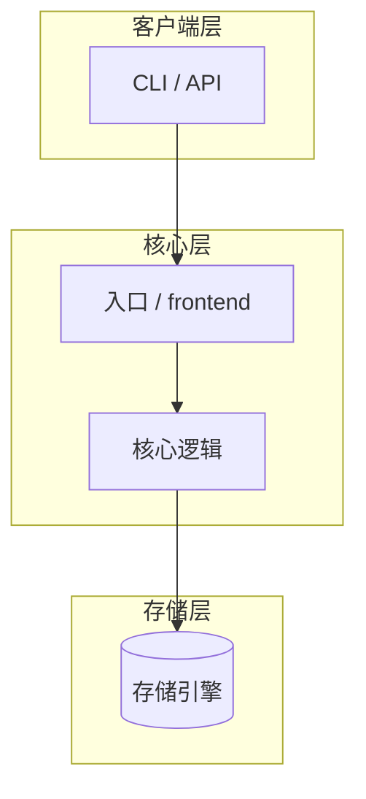
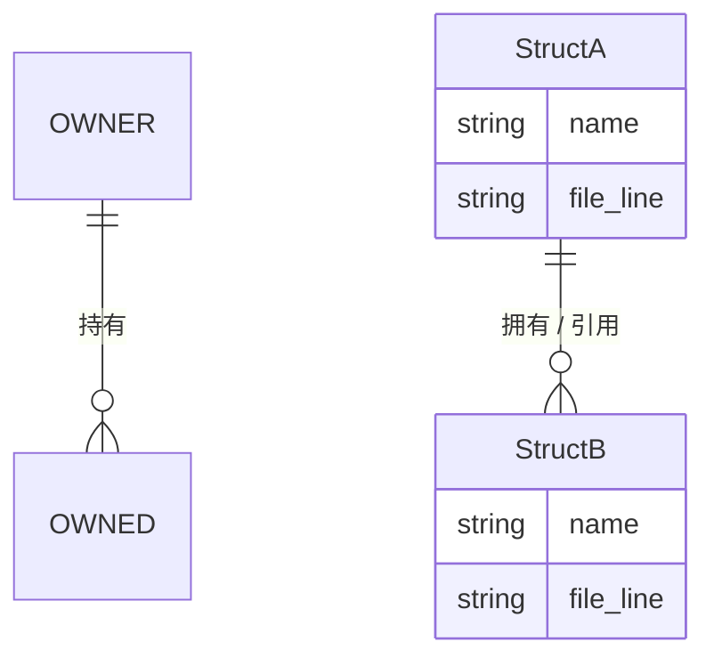
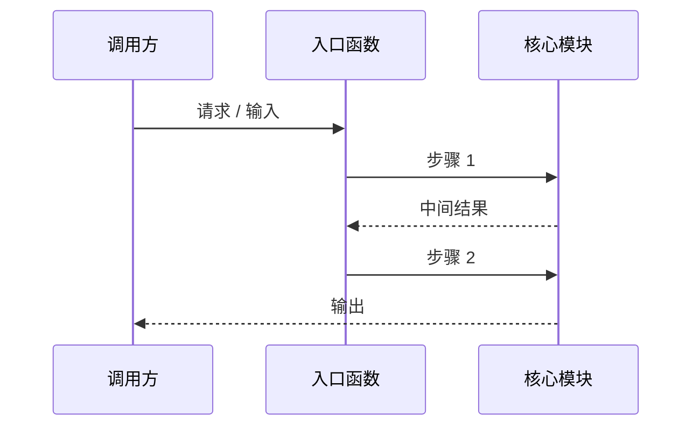

# 读码报告：{项目 / 模块名}

> 由 code-reading 工作流产出。结论标注：**[verified]** = 经运行/调试/测试验证；**[static]** = 仅静态阅读推断。

## 1. 范围与目的

- **目的**（Phase 2，用用户的原话）：{用户想知道什么}
- **环境**（Phase 1）：{项目是否在本地跑起来？用了什么构建命令？如不能运行，原因是什么、回退到了什么手段}
- **结论置信度**：`[verified]` {n} 条 / `[static]` {m} 条；若以 `[static]` 为主，说明原因
- **不在范围内**：{明确排除的部分}

## 2. 架构总览（横向）

{最多 2–5 段。点出顶层组件及其职责。}



> 占位图——替换为该项目的真实组件与依赖关系。

## 3. 核心数据结构及其关系

{定义架构的那几个核心类型。每个说明：谁创建、谁持有、谁修改、生命周期。}

| 结构 | 定义位置 | 创建者 | 持有者 | 修改处 | 作用 |
|---|---|---|---|---|---|
| {StructA} | {file:line} |  |  |  |  |



> 占位图——替换为真实的核心结构及其归属/生命周期关系。

## 4. 纵向分析：{目标流程名}

{逐步叙述执行路径，引用 file:line。包含实际观察到的调用路径。}



> 占位图——替换为真实的调用流，并标注 file:line。

实际观察到的路径（来自 Phase 5 场景，标注 [verified] 或 [static]）：

```
{支撑叙述的调用栈 / 日志片段——保持精简}
```

## 5. 有意留下的黑盒

| 接口 | 输入 | 输出 | 作用 | 为何不展开 |
|---|---|---|---|---|
| {函数/类} |  |  |  | {支线理由} |

## 6. 设计点评与开放问题（Phase 8）

- {为什么选这个数据结构/算法；同类项目如何解决同一问题}
- {如果换我会怎么设计，以及为什么——至少一条}
- {可疑发现：死代码、重复逻辑、缺失的错误处理}

## 7. 后续动作

- [ ] {可深入的方向、值得日后打开的黑盒、尚未覆盖的场景}
